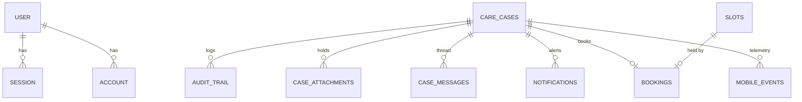
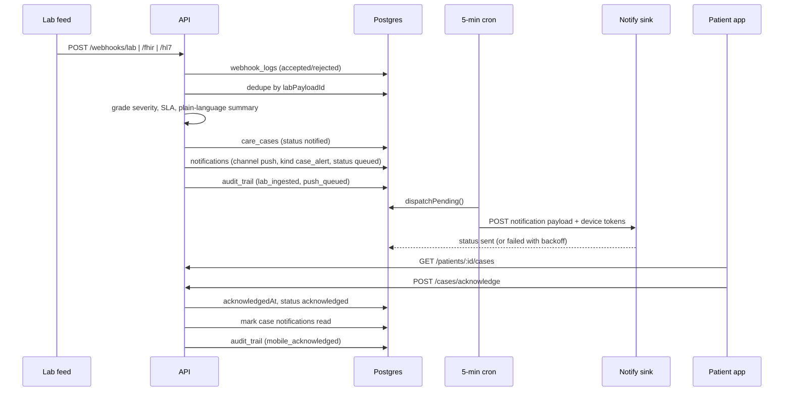
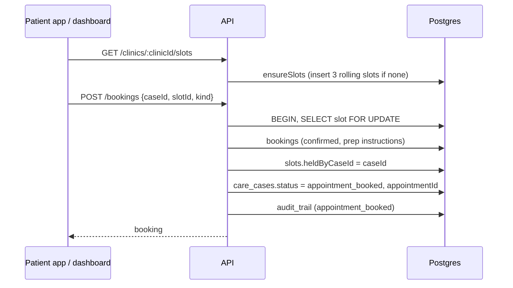
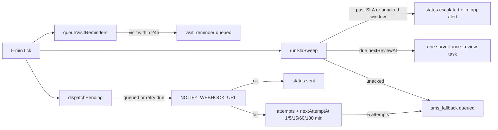
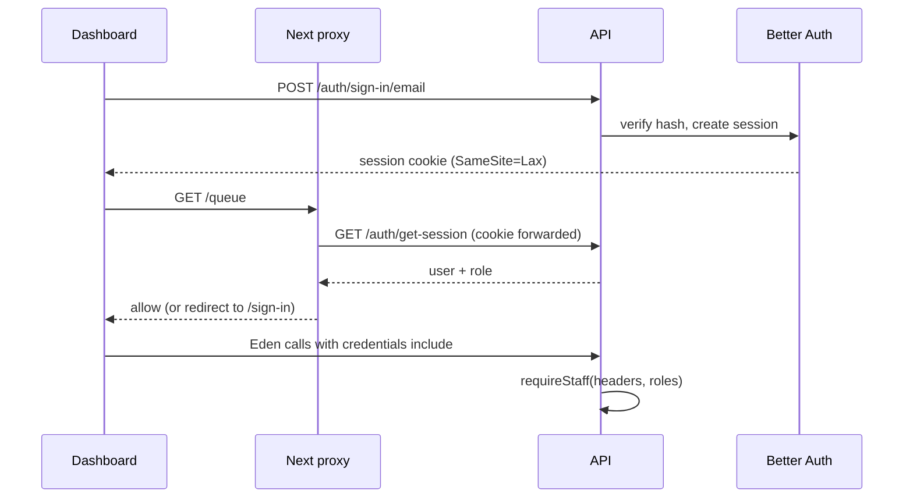

# Hermes — Using the Product and How Data Moves

This is the working manual for Hermes: what each app is for, which control does
what, how each audience gets in and finds every action, and the exact path a
piece of data takes from a lab feed to a signed-off case. It documents the code
in this repository, not an aspiration — where behaviour is still a gap it is
called out in
[Remaining external dependencies](#13-remaining-external-dependencies).

Hermes closes one loop: **screening result → patient alert → acknowledgment →
visit → documented sign-off**, with the coordinator queue holding the case until
a clinician closes it.

---

## 1. The four surfaces

| App | Path | Stack | Port (default) | Audience | Owns |
| --- | --- | --- | --- | --- | --- |
| API | `apps/api` | Bun + Elysia + Drizzle | `8001` (`PORT`) | web, mobile, lab feeds | every read and write, auth, cron jobs |
| Dashboard | `apps/web` | Next.js App Router + Mantine + TanStack Query | `3000` | coordinators, admins | queue, case file, schedule, roster, referrals, admin |
| Patient app | `apps/mobile` | Expo + expo-router | Expo (8081) | patients | results, acknowledgment, teach-back, booking, visits, journey, messages, profile |
| Marketing site | `apps/www` | Astro | `4322` | public | landing page only |

Only the API talks to Postgres. The web app calls it through an Eden treaty
client, the mobile app through a small typed `careApi` fetch client, and the
marketing site only links to the dashboard. Shared DTOs live in
`packages/types`, request/response schemas in `packages/validators`, and all SQL
in `packages/db`.

---

## 2. Running it locally

Prerequisites: Bun 1.4+, Docker (for the compose Postgres), and Xcode/Android
Studio if you want the mobile app on a simulator.

```bash
bun install

# database (host port 5434 so it does not collide with a local Postgres)
docker compose -f infra/docker/docker-compose.yml up -d postgres

cp apps/api/.env.example apps/api/.env
cp apps/web/.env.example apps/web/.env
cp apps/mobile/.env.example apps/mobile/.env
cp packages/db/.env.example packages/db/.env   # DATABASE_URL -> 127.0.0.1:5434

bun run db:migrate          # apply packages/db/src/migrations
bun run db:seed             # sample cases, documents, slots and staff accounts

bun run dev:api             # http://localhost:8001
bun run dev                 # http://localhost:3000  (dashboard)
bun run dev:mobile          # Expo; `bun run update-ip` points it at your LAN IP
bun run dev:www             # http://localhost:4322  (marketing)
```

When `3000`/`8001` are taken, override them (`PORT=3100 bun run --cwd apps/web dev`,
`PORT=18003 bun run --cwd apps/api src/index.ts`) and set
`NEXT_PUBLIC_API_URL` to the API you are actually running.

### Seeded accounts

| Email | Role | Password |
| --- | --- | --- |
| `coordinator@hermescare.test` | coordinator | `hermes-care` |
| `admin@hermescare.test` | admin | `hermes-care` |

The auth seeder **refreshes the password hash of existing accounts** each run, so
changing `COORDINATOR_PASSWORD` / `ADMIN_PASSWORD` in `packages/db/.env` takes
effect without deleting users. Seeded identity is realistic, not placeholder:

- 3 clinic ids (`clinic-1`, `clinic-2`, `specialty-1`) and 19 patients
  (`patient-1-clinic-1` … `patient-4-clinic-1`), each with a unique phone
- 72 cases: 18 hand-written fixtures plus eight weeks of generated history
  (`care-loop/seed/generate.ts`) spread across every patient, severity and
  status, with triage summaries, SLA deadlines, acknowledgements, escalations
  and closures that agree with each other
- 9 routing rules (one intentionally inactive), 6 bookings over future and past
  slots, 14 case messages, 28 notifications, 8 webhook-log rows, 4 device
  tokens, 20 mobile events and 3 case documents

### Seed flags

```bash
bun run db:seed                        # everything missing (idempotent)
bun run db:seed --force                # wipe seeded rows, then reseed
bun run --cwd packages/db db:seed --care-loop
bun run --cwd packages/db db:seed --documents
bun run --cwd packages/db db:seed --booking --notify
bun run --cwd packages/db db:seed --patient --routing
bun run --cwd packages/db db:seed --auth   # create/update the staff accounts
```

`--force` deletes the seeded business tables only; auth users survive.

### Environment matrix

| Variable | Read by | Purpose |
| --- | --- | --- |
| `DATABASE_URL` | API, `packages/db` | Postgres connection |
| `PORT` | API | listen port (default 8001) |
| `NODE_ENV` | API | `development` / `production`; production refuses documented defaults and never returns a login code |
| `API_SECRET` | API | `Authorization: Bearer …` service credential; production needs 24+ characters |
| `TRUST_PROXY` | API | trust `X-Forwarded-For` for rate limits; on only behind Caddy |
| `API_URL` | API | origin Better Auth mounts `/auth` under |
| `FRONTEND_URL` | API | trusted dashboard origin for cookies |
| `BETTER_AUTH_SECRET` | API | session signing secret, also keys patient login-code HMACs |
| `WEBHOOK_SECRET` | API | HMAC secret lab feeds sign with |
| `SMS_WEBHOOK_URL` | API | SMS gateway for patient login codes; required in production |
| `NOTIFY_WEBHOOK_URL` | API | outbound SMS sink; empty = SMS delivery fails loudly |
| `PATIENT_SESSION_DAYS` | API | patient bearer session lifetime (default 30) |
| `PATIENT_CODE_TTL_MINUTES` | API | login code lifetime (default 10) |
| `UPLOAD_DIR` | API | where case documents are written (default `uploads`) |
| `NEXT_PUBLIC_API_URL` | web | API base URL |
| `EXPO_PUBLIC_API_BASE` | mobile | API base URL as seen from the device |

---

## 3. User journeys

Five kinds of people touch Hermes — a public visitor, a patient, a coordinator,
a clinician and an administrator — plus two machine actors (lab feeds and the
cron). This section is the map: how each one gets in for the first time, what
they can do once inside, and the exact screen or endpoint that reaches each
action. The per-surface chapters that follow describe the controls in place;
this one describes the paths through them.

### 3.1 The audiences and their front door

| Audience | Front door | Credential | Lands on | Can create accounts? |
| --- | --- | --- | --- | --- |
| Public visitor | `apps/www` (`:4322`, or the deployed domain) | none | landing page | no |
| Patient | `apps/mobile` (Expo; store build in production) | phone on file + 6-digit SMS code | **Results** tab (intro on first install) | no |
| Coordinator | `apps/web/sign-in` | invited password | **Queue** (`/queue`) | no |
| Clinician | `apps/web/sign-in` | invited password | **Queue**, with consult notes and case closure unlocked | no |
| Administrator | `apps/web/sign-in` | invited password | **Queue** across every clinic, plus the Administration group | yes, staff invites |
| Lab / HIS feed | `POST /webhooks/{lab,fhir,hl7}` | HMAC signature | — | no |
| Background jobs | API process | internal | — | no |

Three rules shape every journey below:

1. **Tenancy.** A coordinator or clinician is bound to one clinic and only ever
   sees that clinic's cases, patients, schedule and referrals. An administrator
   spans clinics (or is bound to one, if assigned) and is the only role that
   reaches `/admin/*`.
2. **No open doors.** There is no public sign-up for staff and no
   self-registration for patients. Staff arrive by invitation, patients arrive
   because the clinic already holds their phone number.
3. **State is on the case, not the screen.** Acknowledgment, ownership, booking,
   referrals and closure all live on the case record, so two people looking at
   the same case see the same state regardless of which screen they opened it
   from.

### 3.2 Public visitor — the marketing site

1. Arrives on any path of `apps/www` (static Astro, no data access).
2. Can switch light/dark with **Switch theme** in the header.
3. Navigates with **For patients**, **For clinics**, **Platform**,
   **Governance**, **FAQ** — all in-page anchors (`#patients`,
   `#how-it-works`, `#features`, `#governance`, `#faq`).
4. Leaves for the product with **Clinic sign in** (header), **I work at a
   clinic** (hero), **Open the clinic dashboard** (CTA block), **Sign in to the
   dashboard** (surfaces card) or **Dashboard** (footer) — all
   `PUBLIC_DASHBOARD_URL`, `http://localhost:3100` by default.
5. Goes to the download section with **Get the app** (header) or **Get the
   patient app** (hero), then to a store listing with the official **App Store**
   or **Google Play** badge (`apps.apple.com` search link, `play.google.com`
   listing).
6. Reads **Privacy** and **Terms** from the footer; **Back to top** returns to
   the hero.

The marketing site cannot sign anyone in and exposes no patient data. A
visitor who is actually a patient is told, in the patient section and the FAQ,
to install the app and sign in with the phone number the clinic holds.

### 3.3 Staff — first entry, invitation to session

An administrator is the only source of staff accounts.

1. **Administrator** signs in and opens **Administration → Staff access**
   (`/admin/staff`).
2. Fills **Invite a staff member**: name, work email, role
   (`coordinator` / `clinician` / `administrator`) and, for the first two, a
   clinic. Submitting calls `POST /staff/invites`.
3. The response carries a one-time invite URL (`/accept-invite?token=…`). It is
   shown **once**, with **Copy**; the invite expires after seven days.
4. **Invitee** opens the link, chooses a password (at least 8 characters,
   confirmed) and submits. `POST /staff/invites/accept` activates the account
   and redirects to `/sign-in?invited=1`.
5. **Invitee** signs in with email and password (`POST /auth/sign-in/email`).
   The Better Auth session cookie is set; `proxy.ts` then lets dashboard routes
   through.
6. `GET /auth/get-session` supplies the name, role and clinic shown in the
   avatar menu. Every API call carries the cookie, and the API re-resolves the
   role itself rather than trusting the browser.
7. **Sign out** lives in the avatar menu and ends the session.

Local development skips steps 1–4: `bun run db:seed --auth` creates the three
accounts listed in [Seeded accounts](#seeded-accounts)
(`coordinator@hermescare.test`, `clinician@hermescare.test`,
`admin@hermescare.test`, password `hermes-care`).

| Account state | What the person sees |
| --- | --- |
| Invite unused, within 7 days | link works once, sets a password |
| Invite used, revoked or older than 7 days | "This invite could not be used." |
| Signed out, any dashboard path | redirected to `/sign-in` |
| Coordinator/clinician with no clinic assigned | API refuses with "This account is not assigned to a clinic. Ask an administrator." |
| Access switch off (`banned`) | sign-in is refused; the switch in **Staff access** turns it back on |
| Password forgotten | no self-service reset exists; an administrator has to re-invite the address |
| Signed in as coordinator, opens `/admin/*` | redirected away; admin routes require `role === "admin"` |

### 3.4 Coordinator — a shift on the queue

The coordinator owns the case from the moment a result lands until a clinician
signs it off, and is the only role that routinely touches every dashboard
surface.

1. **Sign in** → `/queue`. The board is three lanes — **Past the window**,
   **Due within the hour**, **On track** — refetched every 30 seconds.
2. **Narrow the queue**: search by patient, phone or case reference; **Severity**
   (`routine` / `actionable` / `urgent`), **Stage** (`received` / `triaged` /
   `notified` / `acknowledged` / `appointment_booked` / `referred` / `escalated` /
   `closed`), **Owner**, sort newest/oldest, the **Only cases past their
   deadline** checkbox, and **Clear all**. Filters live in the URL
   (`?severity=urgent&status=notified`), so a view can be shared.
3. **Take the N unassigned cases** assigns every unowned case in view to the
   signed-in coordinator (`POST /cases/:id/assign` per case).
4. **Send a test result** (`POST /cases/demo-result`) picks a patient in the
   caller's clinic and pushes a realistic marker through the same triage path as
   a lab feed, so the board can be exercised without an integration.
5. Row **⋯** → **Assign to me**, **Escalate now** (`POST /cases/:id/escalate`,
   queues an in-app alert and a `escalated` audit row) or **Open case**.
6. **Open** a case (`/cases/{id}`) and read the header (severity, status, SLA
   countdown, mobile acknowledgment), the plain-language summary the patient
   received, and the care-continuity card.
7. Assign the **Accountable owner** — the select only lists staff from the
   case's clinics. A case cannot be closed without one.
8. **Book** a slot from the case (`GET /clinics/:clinicId/slots` →
   `POST /bookings`); the case then holds that slot and the other slots lock.
9. Record **Clinical milestones** as they happen: confirmation, consultation
   outcome, treatment start, surveillance / next review, or a structured
   drop-off reason. Each is its own endpoint and its own audit event.
10. Reach the patient: **Messages** tab → **Message to patient** and **Send
    secure message**; or **Trigger push + SMS outreach** for the drafted
    reminder plus an SMS fallback.
11. Hand off with **Referral hand-off** — receiving clinic, hand-off note,
    **Send referral** (`POST /referrals`). The receiving team decides; the
    referring clinic follows the outcome in **Referral history** and on
    `/referrals`.
12. Work the hand-offs: incoming referrals appear on the case under **Referral
    history** with **Accept referral** / **Decline** (a reason of at least three
    characters is required to decline), and **Mark referral completed** once
    accepted. `/referrals` itself is read-only filters (All / Sent / Accepted /
    Declined / Completed) plus **Open case**.
13. Clear the staff worklist at `/tasks`: **Open** / **Done**, **Complete**
    (records actor and time), **Case** to open the record. Tasks arrive from SLA
    escalations, overdue outreach, incoming referrals, surveillance reviews and
    negative teach-back.
14. Day of the visit, at `/appointments`: **Upcoming / Past / All**,
    **Open case**, **Reschedule**, **Cancel** (confirmed, not started), and
    **Attended** / **No-show** once the slot has started.
15. Look someone up at `/patients`: search by name, phone or patient id, then
    **Open case** on their latest case.
16. Upload evidence on the case **Documents** tab: file (PDF, PNG, JPEG, WebP,
    text, ≤10 MB), **Type** (Lab report / Referral letter / Closure evidence /
    Other), **Upload**; the file name opens inline for staff of that clinic.
17. Read the **Audit trail** tab for the ordered history of everything above.

A coordinator **cannot** open **Clinical consult**, cannot close a case (the form
is replaced by a sign-off notice), and cannot reach `/admin/*`; the API refuses
every one of those requests as well, so the UI is a convenience rather than the
control.

### 3.5 Clinician — consult, sign off, receive referrals

A clinician signs in exactly like a coordinator, lands on the same queue, and
can do everything a coordinator can do. Three things are additionally theirs:

1. **Clinical consult** tab on the case file (`GET/POST
   /cases/:id/consult-notes`) — clinician-to-clinician notes. Coordinators do
   not see the tab and the API refuses their requests. The thread is never
   returned to the patient app.
2. **Close case** (`POST /cases/close`) on the **Consult & closure** tab, using
   **Clinical evidence** and **Follow-up plan**. Both fields are required, an
   owner must be assigned, and the status becomes `closed`. Coordinators see the
   form disabled with a note that only a clinician or administrator can close.
3. **Receiving referrals.** Accepting a referral assigns the accepting clinician
   as owner of the receiving case and closes the receiving task.

A typical sign-off path on one case: assign owner → **Confirmation** →
**Consultation** → **Treatment** (or **Drop-off** with a reason) →
**Surveillance** → upload closure evidence → enter clinical evidence and
follow-up plan → **Close case** → the patient sees the closure card and the
audit trail ends with `case_closed`.

### 3.6 Administrator — the governance loop

The administrator sees every clinic's queue and case files, and is the only
role allowed into the Administration group.

1. **Administration → Overview** (`/admin`): time to mobile acknowledgment,
   pending acknowledgments, SLA breach rate, referral conversion, push read
   rate, 7-day retention, closed cases, time to booking, and the severity mix
   with average acknowledgment time per grade (`GET /metrics`).
2. **Clinics** (`/admin/clinics`): **Add clinic** (id, name, timezone); **Edit**
   a row to rename or change timezone; the **Active** switch pauses or
   reactivates a clinic. Pausing keeps people and history but removes the clinic
   from the pickers that create new work. Cards show active clinics, patients,
   staff and open cases.
3. **Staff access** (`/admin/staff`): invite (above); **Copy** the one-time
   link; **Revoke** a pending invite; the staff table's **Role** select
   (coordinator / administrator), **Clinic** select and **Access** switch
   (`banned`) re-point who can do what.
4. **Audit trail** (`/admin/audit`): the latest clinical and access events
   across every clinic, newest first, searchable by action, actor and patient,
   with **Events**, **Actors** and **Affected results** counts
   (`GET /admin/audit`).
5. **Delivery** (`/admin/delivery`): **Run outbox now**
   (`POST /notifications/dispatch`, returns 202 and the number delivered),
   Queued / Sent / Read / Failed / SMS fallback cards, the notification outbox
   table (channel, kind, status, attempts, last error) and the inbound webhook
   log. The 5-minute cron normally does this.
6. **Integrations** (`/admin/webhooks`): the inbound feed log on its own page —
   source, ok/failed, HTTP status and the JSON detail per call.
7. **Routing rules** (`/admin/routing`): **Marker prefix** + **Clinic** +
   **Save rule** (`PUT /routing-rules`, upsert by prefix), **Active** switch per
   rule, **Remove** (`DELETE /routing-rules/:id`). Rules are consulted only when
   a feed does not name a clinic; the longest matching prefix wins and anything
   unmatched falls back to `clinic-1`.

Two current limits are worth knowing: the staff table's **Role** select offers
only coordinator and administrator, so a clinician created by invitation cannot
be switched between roles from the dashboard; and there is no password reset or
"sign in as" for another user.

### 3.7 Patient — from first install to sign-off

**Getting in for the first time**

1. The clinic already holds the patient's phone number (see the provisioning gap
   in §3.10) and the patient installs **Hermes Care** from the store badge on
   the marketing site.
2. Launch lands on **Sign in** (`/sign-in`): phone number plus the SMS/push
   consent checkbox, then **Send my code**
   (`POST /patient-auth/request-code`). Three codes per number per ten minutes;
   asking again invalidates the previous code. Unknown numbers get the same
   response, so the screen cannot be used to discover who is registered.
3. The code arrives by SMS and is valid for 10 minutes. Without
   `SMS_WEBHOOK_URL` (development) the screen shows the `devCode` instead. In
   production, an unavailable SMS gateway returns "Sign-in by SMS is not
   available yet. Contact your clinic."
4. **Sign in** (`POST /patient-auth/verify`) stores the bearer token in
   `expo-secure-store`, records consent (`PATCH /patient-auth/consent`) and
   opens the tabs. Five wrong codes burn the code and require a new one.
5. **Use a different number** goes back a step.

**First run**

6. The six-slide intro at `/onboarding` explains results, booking, privacy and
   alerts. **Next** advances; **Skip** leaves; the alerts slide's primary action
   is **Turn on result alerts** (the system permission prompt, then the push
   token is registered), and **Not now** moves on without prompting — the app
   never asks for alerts anywhere else. The intro is stored per install, so it
   appears once; **Go to my care loop** finishes.

**The loop itself**

7. **Results** tab (`/`) lists **Needs attention** and **Past results**, with
   severity, journey stage and unread-message counts. Pull to refresh; **Try
   again** when offline.
8. A push arrives for a new result. Tapping it deep-links to
   `/care-action?caseId=…` and records `push_opened`.
9. **Care action**: read the result summary, then **I have seen this result**
   (`POST /cases/acknowledge`). Below it, teach-back — **Yes, I understand** or
   **No, I need help**, confidence 1–5, **Send my answer**
   (`POST /patients/:id/cases/:caseId/feedback`; a negative answer opens an
   assigned staff follow-up task). The answer stays editable.
10. **Book** from the visit card or **Next steps → Request a video review**
    (both open `/booking`, the second with `kind=telehealth`): choose a slot and
    **Confirm booking** (`POST /bookings`), or **Confirm new time** when the
    screen was opened to reschedule. **Track your care journey** and **Back to
    result** sit on the same screen.
11. **Add to device calendar** writes the confirmed visit to the phone's
    calendar. The API also queues a reminder 24 hours before the visit.
12. **Visits** tab: next visit with preparation notes, **Open care plan**,
    **Reschedule**, **Cancel visit** (confirmed, then cancels and frees the slot),
    **Also booked**, **Visit history**, or **View your results** when nothing is
    booked.
13. **Care** tab (`/journey`): Received → Booked → Consultation → Completed with
    the current step called out; with no `caseId` it shows the most recent case.
14. **Messages**: conversation list → thread → composer → send
    (`POST /patients/:id/cases/:caseId/messages`), which marks the coordinator
    side read and records `message_sent`.
15. **Notifications** (`/notifications`): every alert grouped by day; opening an
    unread row marks it read and, when it belongs to a case, opens the care
    action screen.
16. **Profile**: identity header and account rows (patient id, phone, clinic);
    **Appearance** System / Light / Dark; **Push notifications** and **SMS
    fallback** switches (`PATCH /patient-auth/consent`); **Notification
    history**; **Unlock with fingerprint or Face ID** (off by default, gates the
    Results tab and the care action screen only); **Sign out**
    (`POST /patient-auth/sign-out`, which revokes the token server-side).

**Coming back later**

17. A stored token (30 days by default) opens straight into the tabs; the intro
    does not repeat. `GET /patient-auth/session` restores the cached profile.
18. After **Sign out** the token is dead and the app returns to `/sign-in`; the
    patient needs a fresh SMS code.

| Edge case | What the patient meets |
| --- | --- |
| Phone not on file | normal "code sent" response, no code arrives |
| Three codes in ten minutes | "That is three codes in ten minutes…" (HTTP 429) |
| Code older than 10 minutes | "That code is not valid." |
| Five wrong codes | "This code has been entered too many times. Ask for a new code." |
| API unreachable | **Try again** card on Results |
| No results yet | empty state pointing at the clinic |
| Biometric prompt cancelled | "Unlock cancelled. Your results stay hidden until you confirm." |
| Case closed by the clinician | closure card replaces the booking prompt |
| No EAS `projectId` | push registration skipped; in-app alerts only |

### 3.8 The hand-off chain, end to end

| Moment | Who acts | Where | What changes |
| --- | --- | --- | --- |
| Result arrives | lab / HIS | `POST /webhooks/{lab,fhir,hl7}` | case created, severity graded, SLA set, patient alerted |
| Case lands | coordinator | `/queue` | owner assigned, case opened |
| Patient is told | coordinator | case **Messages** / outreach | push + SMS queued, `outreach_triggered` audited |
| Patient answers | patient | mobile **Care action** | `mobile_acknowledged`, teach-back recorded |
| Visit is arranged | patient or coordinator | mobile **Booking** / case **Book** | slot held, booking confirmed, reminder queued |
| Visit happens | coordinator | `/appointments` | attended or no-show recorded |
| Clinical work | clinician | case **Consult & closure** | confirmation, consultation, treatment, surveillance |
| Specialist needed | clinician / coordinator | case **Referral hand-off** | referral `sent`; receiving clinic owns the decision |
| Receiving clinic decides | receiving clinician | case **Referral history** | `accepted` (owner assigned) or `declined` (re-route task) |
| Case ends | clinician | case **Close case** | `closed`, closure plan visible to the patient |
| Anything at all | anyone later | case **Audit trail**, `/admin/audit` | immutable ordered record |

### 3.9 Reaching any screen directly

Dashboard paths (session required; `/admin/*` also requires the admin role):

| Path | Screen | Notable query/params |
| --- | --- | --- |
| `/sign-in` | staff sign-in | `?invited=1` shows the invited banner |
| `/accept-invite` | set a password | `?token=…` |
| `/` | redirect | → `/queue` |
| `/queue` | queue board | `?severity=&status=&ownership=&overdue=&q=&sort=` |
| `/cases/[id]` | case file, tabs `actions` / `messages` / `consult` / `documents` / `audit` | — |
| `/appointments` | clinic schedule | `?when=upcoming\|past\|all&status=&q=` |
| `/patients` | patient roster | `?q=&load=&sort=` |
| `/referrals` | referral inbox | `?status=&q=` |
| `/tasks` | staff worklist | `?status=open\|done&kind=&q=` |
| `/admin` | overview metrics | — |
| `/admin/clinics` | clinic directory | — |
| `/admin/staff` | staff access and invites | — |
| `/admin/audit` | global audit trail | search |
| `/admin/delivery` | outbox and webhook log | — |
| `/admin/webhooks` | inbound feed log | — |
| `/admin/routing` | routing rules | — |

Patient app paths (token in secure storage; `_layout.tsx` redirects between
`/sign-in` and the tabs):

| Path | Screen | Params |
| --- | --- | --- |
| `/sign-in` | phone + code | — |
| `/onboarding` | six-slide intro | — |
| `/(tabs)/index` | Results | — |
| `/(tabs)/journey` | Care timeline | `?caseId=` (optional) |
| `/(tabs)/visits` | Visits | — |
| `/(tabs)/messages` | conversations, or a thread | `?caseId=` |
| `/(tabs)/profile` | Profile and settings | — |
| `/care-action` | result detail, ack, teach-back | `?caseId=` (required) |
| `/booking` | pick or move a slot | `?caseId=&clinicId=&kind=in_person\|telehealth`, plus `bookingId` to reschedule |
| `/notifications` | notification centre | — |

### 3.10 What is deliberately not possible

- **No staff self-sign-up** and no social login; invitations only, seven-day
  single-use links.
- **No patient self-registration.** Patients exist because the clinic's
  directory holds them; there is no dashboard screen or API route to create one,
  so today they come from the seed (`+254711000101` …) or a database load. This
  is the largest missing journey and the one to close before real clinics
  onboard.
- **No patient account editing** in the app (phone, name, clinic are read-only),
  and **no password reset** for staff.
- **No deletion.** Clinics are paused, not removed; cases are closed, not
  deleted; attachments are immutable once uploaded.
- **No patient web portal** and **no staff mobile app** — the mobile app is
  patient-only, the dashboard is staff-only.
- **No impersonation or "sign in as"**, and no cross-clinic browsing for a
  clinic-bound coordinator.
- **No ad-hoc booking** without a case: both the dashboard and the app book
  through `/bookings`, which checks the case and its clinic.

---

## 4. Using the dashboard (`apps/web`)

### 4.1 Signing in — `/sign-in`

| Control | What it does |
| --- | --- |
| **Work email** | staff email |
| **Password** | staff password |
| **Sign in** | `POST /auth/sign-in/email`; on success the session cookie is set and `proxy.ts` lets the route through |

There is no public sign-up and no social provider. An administrator creates a
staff account from **Administration → Staff access**, which returns a one-time
`/accept-invite?token=…` link; the invitee sets a password there and signs in.
`proxy.ts` reads the Better Auth session cookie on every dashboard request and
redirects signed-out visitors to `/sign-in`; `/admin/*` additionally requires
`role === "admin"`.

### 4.2 Shell — left navigation and user menu

| Control | Destination | Visible to |
| --- | --- | --- |
| **Hermes** wordmark | `/queue` (closes the mobile drawer) | everyone |
| **Queue** | `/queue` | everyone |
| **Appointments** | `/appointments` | everyone |
| **Patients** | `/patients` | everyone |
| **Referrals** | `/referrals` | everyone |
| **Tasks** | `/tasks` | everyone |
| **Overview** | `/admin` | admin |
| **Clinics** | `/admin/clinics` | admin |
| **Audit trail** | `/admin/audit` | admin |
| **Delivery** | `/admin/delivery` | admin |
| **Integrations** | `/admin/webhooks` | admin |
| **Routing rules** | `/admin/routing` | admin |
| **Staff access** | `/admin/staff` | admin |
| Avatar / name / role menu → **Sign out** | ends the session | everyone |

The mark beside the wordmark changes with the surface: the clinic plus on queue
and case pages, the admin shield inside `/admin`.

### 4.3 Clinic schedule — `/appointments`

Every visit at your clinic, with the patient and the result behind it, refetched
every 30 seconds.

| Control | What it does |
| --- | --- |
| **Upcoming / Past / All** | filters the table by booking status and slot time |
| **Open case** (row) | `/cases/{id}` |
| **Reschedule** (row) | opens the reschedule modal; `POST /bookings/:id/reschedule` moves the visit to another open slot |
| **Cancel** (row) | `POST /bookings/:id/cancel`; only for confirmed visits that have not started |
| **Attended** / **No-show** (row) | `PATCH /bookings/:id/outcome` once the slot has started |

Metric cards: **Upcoming**, **Today**, **Attended**, **Cancelled or missed**.
Cancelled rows are muted.

### 4.4 Patient roster — `/patients`

Everyone registered at the clinic with their open care load and latest result.

| Control | What it does |
| --- | --- |
| Search | filters by name, phone or patient id |
| **Open case** (row) | `/cases/{lastCaseId}` |

Metric cards: **Patients**, **Open cases**, **With a result on file**.

### 4.5 Referral inbox — `/referrals`

Every hand-off into or out of the clinic, read from `GET /clinic/referrals`.
Accept, decline and complete decisions still happen on the case file.

| Control | What it does |
| --- | --- |
| **All / Sent / Accepted / Declined / Completed** | filters by referral status |
| **Open case** (row) | `/cases/{caseId}` |

Metric cards: **Awaiting decision**, **Accepted**, **Declined**, **Completed**.

### 4.6 Tasks — `/tasks`

The staff worklist for everything that still needs a person: SLA escalations,
overdue outreach, incoming referrals, surveillance reviews and patient
follow-ups raised by negative teach-back. It refetches every 30 seconds and is
clinic-scoped like the queue.

| Control | What it does |
| --- | --- |
| **Open / Done** | switches `GET /tasks?status=open` and `status=done` |
| **Complete** (row) | `POST /tasks/:id/complete`; records the actor and timestamp, then refreshes the list |
| **Case** (row) | opens `/cases/{id}` |

Metric cards show **In view**, **Overdue**, **Surveillance** and **Patient
follow-up**. Overdue rows use the same breach treatment as the queue.

### 4.7 Queue — `/queue`

A lane board rather than a flat table: **Past the window**, **Due within the
hour** and **On track**, refetched every 30 seconds. Filters live in the URL
(`?severity=urgent&status=notified`, lowercase values) so a view can be shared.

| Control | What it does |
| --- | --- |
| **Send a test result** | `POST /cases/demo-result` as the signed-in staff member; the API picks a patient in the caller's clinic, posts a realistic marker through the same triage path as a lab feed, then the board refreshes |
| **Narrow the queue** (toolbar) | search by patient, phone or case reference; sort newest/oldest; **Clear all** resets every filter |
| **Severity / Stage / Owner** | how fast the result needs a decision, where it sits on the way to sign-off, and whether anyone owns it |
| **Only cases past their deadline** | checkbox that hides everything still inside its window |
| **Take the N unassigned cases** | assigns every unowned case in view to you |
| **Open** (row) | `/cases/{id}` |
| **⋯ (row)** | assign to me, escalate, or open the case file — destructive actions sit last |

Metric cards: **In view**, **Waiting on the patient**, **Past the deadline** and
**No owner**. Lanes show a count, a one-line description and an empty state, and
each row carries the severity pill, the plain-language summary the patient saw,
the case reference, phone number and remaining (or elapsed) time.

### 4.8 Case file — `/cases/[id]`

Breadcrumb **Queue** returns to the worklist. The header shows the severity,
status, SLA countdown and mobile acknowledgment state. Below it sit three cards:
the exact plain-language summary the patient received, a care-continuity card
(owner, confirmation, consultation, treatment, surveillance and the patient's
teach-back answer) and state notices for escalated or closed cases.

**Tab 1 — Consult & closure**

| Control | What it does |
| --- | --- |
| Slot rows + **Book** | `GET /clinics/:clinicId/slots` then `POST /bookings`; a booked slot shows **Booked**, and other slots lock once the case holds one |
| **Accountable owner** | `POST /cases/:id/assign`; the team select only offers staff from the case's clinics |
| **Clinical milestones** | Records confirmation, consultation outcome, treatment start, surveillance/next review and a structured drop-off reason |
| **Receiving clinic** + **Hand-off note** + **Send referral** | `POST /referrals` creates a `sent` referral; the receiving team accepts, declines or completes it |
| **Clinical evidence**, **Follow-up plan** + **Close case** | `POST /cases/close`; clinician/admin only, both fields required, an owner must be assigned, status becomes `closed` |
| **Open work** | Lists escalation, overdue and referral tasks; **Done** completes the task |

**Tab 2 — Messages**

| Control | What it does |
| --- | --- |
| **Message to patient** + **Send secure message** | `POST /cases/:id/messages` as `coordinator`; the thread shows read/unread state |
| **Trigger push + SMS outreach** | `POST /cases/:id/outreach` — stores the draft (or a fallback reminder), queues an SMS fallback and writes `outreach_triggered` to the audit trail |

**Tab 3 — Clinical consult**

Clinician-to-clinician notes via `GET/POST /cases/:id/consult-notes`. The tab is
only rendered for clinicians and admins; coordinators cannot read the thread
and the API rejects their requests. The referring and receiving clinical teams
share it; it is never returned to the patient app.

**Tab 4 — Documents**

| Control | What it does |
| --- | --- |
| **File** | PDF, PNG, JPEG, WebP or plain text, up to 10 MB |
| **Type** | Lab report, Referral letter, Closure evidence, Other |
| **Upload** | `POST /cases/:id/attachments` as multipart; file goes to the API server's disk, metadata to `case_attachments`, `attachment_uploaded` to the audit trail |
| File name link | `GET /attachments/:id`, opens inline for staff of that clinic or for the owning patient's bearer token |

**Tab 5 — Audit trail** — every transition in order: `lab_ingested`,
`push_queued`, `mobile_acknowledged`, `appointment_booked`, `referral_linked`,
`confirmation_recorded`, `consultation_recorded`, `treatment_recorded`,
`surveillance_recorded`, `referral_accepted`/`declined`, `case_assigned`,
`consult_note_added`, `attachment_uploaded`, `outreach_triggered`, `escalated`,
`auto_escalated`, `case_closed`.

### 4.9 Administration

**Overview — `/admin`**

| Card | Meaning |
| --- | --- |
| Time to mobile ack | mean hours from case creation to acknowledgment |
| Pending mobile ack | notified/escalated cases with no patient tap |
| SLA breach rate | past-due cases without an in-window acknowledgment |
| Referral conversion | share of cases with a downstream clinic linked |
| Push read rate | push alerts with a read timestamp |
| 7-day retention | patients opening the app in the last 7 days who also opened it 7–14 days ago |
| Closed cases, Time to booking | closure count and hours from result to booking |
| Routine / Actionable / Urgent counts | severity mix, with average ack time per grade |

**Clinics — `/admin/clinics`**

| Control | What it does |
| --- | --- |
| **Add clinic** | `POST /admin/clinics` with id, name and timezone |
| **Edit** (row) | renames the clinic or changes its timezone via `PATCH /admin/clinics/:id` |
| Active switch (row) | pauses or reactivates a clinic without deleting it |
| Metric cards | Active clinics, Patients, Staff, Open cases |

A paused clinic keeps its people and history but stops appearing in the pickers
that create new work.

**Delivery — `/admin/delivery`**

| Control | What it does |
| --- | --- |
| **Run outbox now** | `POST /notifications/dispatch`, returns `202` and the number delivered; normally the 5-minute cron does this |
| Metric cards | Queued, Sent, Read, Failed, SMS fallback |
| Notification outbox table | channel, kind, status, attempts, last error per row |
| Webhook log table | inbound feed audit with source, ok/failed, status and JSON detail |

**Integrations — `/admin/webhooks`** — the inbound webhook log on its own page.

**Audit trail — `/admin/audit`** — `GET /admin/audit`, the latest clinical and
access events across every clinic, newest first, with a search over action,
actor and patient plus **Events**, **Actors** and **Affected results** cards.

**Routing rules — `/admin/routing`**

| Control | What it does |
| --- | --- |
| **Marker prefix** + **Clinic** + **Save rule** | `PUT /routing-rules` (upsert by prefix) |
| Active switch (row) | enables/disables a rule without deleting it |
| **Remove** (row) | `DELETE /routing-rules/:id` |

Rules are consulted only when a lab feed does not name a clinic; the longest
matching marker prefix wins and anything unmatched falls back to `clinic-1`.

---

## 5. Using the patient app (`apps/mobile`)

The app launches into sign-in, then a first-run intro once the patient is in;a stored patient token skips the intro on later launches. Tabs are **Results**,
**Care**, **Visits**, **Messages** and **Profile**. Biometric unlock is off by
default and, when the patient turns it on in Profile, sits in front of the two
screens that render a result — Home and the care-action screen — not the whole
app.

### 5.1 Sign-in — `/sign-in`

The patient enters the phone number their clinic holds, accepts the SMS and push
consent checkbox and requests a 6-digit code. Without `SMS_WEBHOOK_URL` the API
returns `devCode` and the screen shows it (development only). Verifying stores
the bearer token in `expo-secure-store` and records consent through
`PATCH /patient-auth/consent`. The token is attached to every patient request;
`/patient-auth/session` restores the cached profile on launch.

| Control | What it does |
| --- | --- |
| **Phone number** | the number on file; `POST /patient-auth/request-code` is rate limited |
| Consent checkbox | required before a code is requested |
| **Send my code** | requests the one-time code |
| **6-digit code** + **Sign in** | `POST /patient-auth/verify`; the token is stored and the tabs open |
| **Use a different number** | returns to the phone step |

That device is now the session: `_layout.tsx` sends signed-out visitors to
`/sign-in` and signed-in visitors away from it.

### 5.2 First-run intro — `/onboarding`

Six swipeable slides (welcome, what a result means, booking, who can see it,
alerts, ready) with an animated paginator, a slide counter, **Next**, **Skip**
and, on the alerts slide, **Turn on result alerts** — the one place the app asks
for notification permission, then registers the push token. The slide can be
skipped with **Not now**. Finishing writes the flag in `expo-secure-store`, so
the intro appears once per install.

### 5.3 Biometric unlock — Home and care action

Off until the patient enables **Unlock with fingerprint or Face ID** in
Profile, so a first launch never asks for a fingerprint.

| State | Control | Result |
| --- | --- | --- |
| checking | — | "Checking…" |
| locked | **Unlock with biometrics** | Face ID / fingerprint via `expo-local-authentication` |
| unlocked (setting off) | — | renders the screen without a prompt |
| enabled but no enrolment | — | renders the screen; Profile explains the device has nothing set up |

A cancelled prompt keeps the results hidden and shows
"Unlock cancelled. Your results stay hidden until you confirm."

### 5.4 Home — `/`

| Control | What it does |
| --- | --- |
| Result row under **Needs attention** | opens `/care-action?caseId=…`; shows severity, journey stage and unread messages |
| Result row under **Past results** | same screen, for closed cases |
| Pull to refresh | reloads `GET /patients/:id/cases` |
| **Try again** | shown when the API is unreachable |
| Push notification tap | deep-links to `/care-action?caseId=…` and logs `push_opened` |

On load the app records `app_open`, registers an Expo push token with
`POST /patients/:id/devices` (skipped without an EAS `projectId`), and switches
to in-app alerts only when push is unavailable. Sign-out lives on the Profile
tab.

### 5.5 Care action — `/care-action?caseId=…`

Opening the screen logs `case_viewed`, marks coordinator messages read and marks
the case's push alerts read. Cards render in this order: result summary, closure
(after sign-off), booked visit, acknowledgment, teach-back, next steps.

| Control | What it does |
| --- | --- |
| **I have seen this result** | `POST /cases/acknowledge` (`caseId` + `patientId`); idempotent, records `mobile_acknowledged` |
| **Yes, I understand** / **No, I need help** + confidence 1–5 + **Send my answer** | teach-back via `POST /patients/:id/cases/:caseId/feedback`; a negative answer opens a staff follow-up task |
| **Add to device calendar** (visit card) | writes the booked visit to the device calendar |
| **Next steps** | explains what happens after acknowledgment |

The booking and messaging entries in the old layout are now the **Visits** and
**Messages** tabs; the case still links across to both.

### 5.6 Booking — `/booking`

| Control | What it does |
| --- | --- |
| Slot row | selects a slot (`GET /clinics/:clinicId/slots`) |
| **Confirm booking** | `POST /bookings`, logs `booking_confirmed`, schedules the 24-hour local reminder |
| **Track your care journey** | `/journey?caseId=…` |
| **Back to result** | returns to the care action screen |

With a `bookingId` param the same screen reschedules an existing visit through
`POST /bookings/:id/reschedule` and titles itself "Choose a new time".

### 5.7 Visits — `/visits`

| Control | What it does |
| --- | --- |
| Next-visit panel | date, clinic, kind and the preparation note for the soonest confirmed visit |
| **Open care plan** | `/care-action?caseId=…` for that booking |
| **Reschedule** | opens `/booking` with the booking and slot, which moves it to another open slot |
| **Cancel visit** | `POST /bookings/:id/cancel` after confirming, then refreshes the tab |
| **Also booked** | later confirmed visits, each opening its care plan |
| **Visit history** | attended, missed and cancelled visits with their status |
| **View your results** | shown instead of the panel when nothing is booked |

### 5.8 Care journey — `/journey`

Received → Booked → Consultation → Completed, derived from the case, booking,
referral and closure fields. With no `caseId` the tab shows the most recent case.

### 5.9 Messages — `/messages`

A conversation list across the patient's cases; selecting one opens the secure
thread. The composer sends
`POST /patients/:id/cases/:caseId/messages`, marks the coordinator side read and
logs `message_sent`.

### 5.10 Profile — `/profile`

| Control | What it does |
| --- | --- |
| Identity header + **Account** rows | name, clinic, phone and patient id from the cached profile |
| **Appearance** | System / Light / Dark, stored through `lib/theme-preference.ts` |
| **Push notifications**, **SMS fallback** switches | `PATCH /patient-auth/consent` |
| **Notification history** | opens `/notifications` |
| **Sign out** | revokes the token server-side and returns to `/sign-in` |

### 5.11 Notification centre — `/notifications`

Every alert the clinic sent, grouped by day. Opening an unread row marks it read
(`POST /patients/:id/notifications/:id/read`) and, when the alert belongs to a
case, opens `/care-action?caseId=…`.

---

## 6. Marketing site (`apps/www`)

Astro, static, no data access. Links:

| Control | Destination |
| --- | --- |
| **Hermes** wordmark / home | `/` |
| **How it works**, **Platform**, **Governance**, **FAQ** | in-page anchors |
| **Open dashboard** (header, hero, CTA block, footer) | `PUBLIC_DASHBOARD_URL` (defaults to `http://localhost:3100`) |
| **See how the loop closes** / **Read the loop again** | `#how-it-works` |

---

## 7. The API

Base URL is whatever `PORT` serves; all examples assume `http://localhost:8001`.

### 7.1 Credentials

| Mode | Used by | How |
| --- | --- | --- |
| Staff session | dashboard | Better Auth cookie (`credentials: "include"`), resolved via `/auth/get-session` |
| Service bearer | scripts, jobs | `Authorization: Bearer $API_SECRET` |
| Patient bearer | mobile | opaque token from `/patient-auth/verify`; hashed at rest, scoped by patient id |
| HMAC signature | lab feeds | `x-hermes-timestamp` + `x-hermes-signature` over `${timestamp}.${raw body}` |

Staff reads and writes require `coordinator` or `admin`, and coordinators only
see their assigned clinic. Patient routes require a patient token whose patient
id matches the path. Webhooks require a valid, unexpired, single-use signature.

### 7.2 Endpoints

| Method | Path | Auth | Purpose |
| --- | --- | --- | --- |
| GET | `/health` | — | liveness |
| GET | `/ready` | — | database readiness |
| ALL | `/auth/*` | — | Better Auth (sign-in, sign-out, session) |
| POST | `/patient-auth/request-code` | — | SMS login code (rate limited) |
| POST | `/patient-auth/verify` | — | exchange code for a bearer token |
| GET | `/patient-auth/session` | patient | current patient profile |
| POST | `/patient-auth/sign-out` | patient | revoke the token |
| PATCH | `/patient-auth/consent` | patient | update push/SMS consent |
| POST | `/webhooks/lab` | HMAC | canonical JSON lab result |
| POST | `/webhooks/fhir` | HMAC | FHIR R4 `Observation` |
| POST | `/webhooks/hl7` | HMAC | HL7v2 `ORU^R01` message |
| GET | `/clinics` | staff | clinics for filters and invites |
| GET | `/clinic/appointments` | staff | clinic schedule: booking, patient and case per visit |
| GET | `/clinic/patients` | staff | patient roster with care load and latest result |
| GET | `/clinic/referrals` | staff | referral inbox and history for the clinic |
| GET | `/staff/users` | admin | staff accounts |
| PATCH | `/staff/users/:id` | admin | role, clinic and access |
| GET/POST | `/staff/invites` | admin | list/create invites |
| DELETE | `/staff/invites/:id` | admin | revoke an invite |
| POST | `/staff/invites/accept` | — | set a password from an invite |
| GET | `/routing-rules` | staff | list rules |
| PUT | `/routing-rules` | staff | upsert a rule |
| DELETE | `/routing-rules/:id` | staff | remove a rule |
| GET | `/cases?severity=&status=` | staff | queue list (clinic-scoped) |
| GET | `/cases/:id` | staff/patient | full case detail (messages, notifications, booking, slot, attachments) |
| GET | `/cases/:id/messages` | staff/patient | thread |
| POST | `/cases/:id/messages` | staff | send a secure message |
| POST | `/cases/:id/outreach` | staff | message + queued SMS fallback |
| POST | `/cases/:id/escalate` | staff | mark escalated, queue in-app alert |
| POST | `/cases/:id/assign` | staff | set or clear the accountable owner |
| POST | `/cases/:id/confirmation` | staff | record confirmatory outcome and notes |
| POST | `/cases/:id/consultation` | staff | record clinical review outcome |
| POST | `/cases/:id/treatment` | staff | record treatment start |
| POST | `/cases/:id/surveillance` | staff | set surveillance plan and next review |
| POST | `/cases/:id/drop-off` | staff | record a structured delay/drop-off reason |
| GET/POST | `/cases/:id/consult-notes` | clinician/admin | internal clinician-to-clinician thread |
| GET | `/staff/team` | staff | assignable care-team members |
| GET | `/tasks?status=open\\|done` | staff | clinic work items |
| POST | `/tasks/:id/complete` | staff | complete a work item |
| POST | `/cases/acknowledge` | patient id | idempotent acknowledgment |
| POST | `/cases/:id/attachments` | staff | multipart upload |
| GET | `/cases/:id/attachments` | staff | list attachments |
| GET | `/attachments/:id[?patientId=]` | staff or owner | stream the file |
| GET | `/clinics/:clinicId/slots` | staff/patient | slots (created on first read) |
| POST | `/bookings` | staff/patient | book a slot (case ownership and clinic checked) |
| POST | `/bookings/:id/cancel` | staff/patient | cancel a confirmed visit and release the slot |
| POST | `/bookings/:id/reschedule` | staff/patient | move a confirmed visit to another slot |
| PATCH | `/bookings/:id/outcome` | staff | mark a started visit attended or no-show |
| POST | `/referrals` | staff | create a referral (`sent`) |
| GET | `/referrals?direction=incoming\\|outgoing` | staff | referral inbox/history |
| POST | `/referrals/:id/accept` | receiving staff | accept, assign an owner and close the receiving task |
| POST | `/referrals/:id/decline` | receiving staff | decline with a reason; origin gets a re-route task |
| POST | `/referrals/:id/complete` | receiving staff | complete the accepted referral |
| POST | `/cases/close` | clinician/admin | clinical sign-off (requires an assigned owner) |
| GET | `/metrics` | staff | governance metrics |
| GET | `/admin/clinics` | admin | clinic directory with activity counts |
| POST | `/admin/clinics` | admin | create a clinic (id, name, timezone) |
| PATCH | `/admin/clinics/:id` | admin | activate or pause a clinic |
| GET | `/admin/audit` | admin | global audit trail |
| GET | `/audit/:caseId` | staff/patient | audit trail |
| GET | `/notifications?caseId=\|patientId=` | staff | outbox rows |
| GET | `/notifications/stats` | staff | delivery counts |
| POST | `/notifications/dispatch` | staff | drain the outbox now |
| GET | `/webhooks/logs` | staff | inbound feed log |
| GET | `/patients/:patientId/cases` | patient scope | patient case list |
| GET | `/patients/:patientId/bookings` | patient scope | that patient's visits with slot and clinic |
| GET | `/patients/:patientId/cases/:caseId` | patient scope | case + messages + notifications |
| POST | `/patients/:patientId/cases/:caseId/read` | patient scope | mark messages read |
| GET/POST | `/patients/:patientId/cases/:caseId/messages` | patient scope | thread |
| POST | `/patients/:patientId/cases/:caseId/feedback` | patient scope | teach-back; `understood: false` opens an assigned follow-up task |
| POST | `/patients/:patientId/cases/:caseId/events` | patient scope | telemetry with a case |
| POST | `/patients/:patientId/events` | patient scope | telemetry |
| GET | `/patients/:patientId/notifications` | patient scope | patient alerts |
| POST | `/patients/:patientId/notifications/:id/read` | patient scope | mark read (ownership in the WHERE clause) |
| POST | `/patients/:patientId/devices` | patient scope | register a push token |

### 7.3 Ingesting a result

```bash
BODY='{
  "patientId": "patient-3-clinic-1",
  "clinicId": "clinic-1",
  "facilityId": "riverbend-lab",
  "markerCode": "ldl",
  "markerValue": 195,
  "unit": "mg/dL",
  "takenAt": "2026-11-06T08:00:00.000Z"
}'
TS=$(date +%s)
SIG=$(printf '%s.%s' "$TS" "$BODY" | openssl dgst -sha256 -hmac "$WEBHOOK_SECRET" -hex | awk '{print $2}')
curl -s localhost:8001/webhooks/lab \
  -H 'content-type: application/json' \
  -H "x-hermes-timestamp: $TS" \
  -H "x-hermes-signature: sha256=$SIG" \
  --data-binary "$BODY"
```

Unsigned calls get 401, a stale timestamp gets 401, and a replayed signature
gets 409. Signatures are recorded in `webhook_receipts` and pruned after 24h.

Response: `{ caseId, severity, slaDueAt, summary, duplicate }`.

- `clinicId` is required on this JSON feed; FHIR and HL7 feeds may omit it and
  fall through to `routing_rules`.
- Deduplication uses `labPayloadId` (the `rawHl7Fhir` value, `fhir_<id>`, or a
  generated `lab_<uuid>`). A repeat returns `duplicate: true` with the original
  case, without new audit rows or alerts.
- FHIR: `subject.reference` → patient, first `code.coding.code` (LOINC) → marker,
  `valueQuantity` → value/unit, `performer[0]` → facility, `id` → idempotency key.
- HL7: `MSH-9` message id, `PID-3` patient id, one result per numeric `OBX`
  (`OBX-3` marker, `OBX-5` value, `OBX-6` unit, `OBX-14` timestamp).

### 7.4 Triage and SLAs

| Marker | Threshold | Severity |
| --- | --- | --- |
| glucose ≥ 200, hba1c ≥ 9, potassium ≥ 6, sodium < 125, troponin ≥ 0.4, bp_sys ≥ 180 | — | Urgent |
| ldl ≥ 190, creatinine ≥ 2, potassium ≥ 5.3, any value ≥ 1000 | — | Actionable |
| everything else | — | Routine |

| Severity | SLA | Escalation window |
| --- | --- | --- |
| Urgent | 4 hours | unacknowledged after 48 h |
| Actionable | 48 hours | unacknowledged after 48 h |
| Routine | 168 hours | unacknowledged after 168 h |

Grading is pure and unit-tested (`apps/api/tests/triage.test.ts`). LOINC codes
are canonicalised first (`4548-4` → `hba1c`, `2345-7` → `glucose`, and so on),
so coded and named feeds behave identically.

---

## 8. Data model



| Table | Key columns | Notes |
| --- | --- | --- |
| `clinics` | text `id`, `name`, `timezone`, `isActive` | tenancy boundary; pausing a clinic keeps its history |
| `patients` | text `id` (clinic identifier), `clinicId`, `name`, `phone` unique, `email`, `dateOfBirth`, `pushConsent`, `smsConsent` | directory and mobile login identity |
| `patient_sessions` | `patientId`, `tokenHash` unique, `expiresAt`, `revokedAt`, `lastUsedAt` | bearer sessions for the patient app |
| `patient_login_codes` | `patientId`, `codeHash`, `expiresAt`, `attempts`, `consumedAt` | one-time SMS codes |
| `care_cases` | `id` uuid, `patientId`, `clinicId`, `labPayloadId`, `severity`, `status`, `slaDueAt`, `summaryPlainLanguage`, `acknowledgedAt`, `assignedToId`, `appointmentId`, `referralClinicId`, `confirmationStatus`, `confirmedAt`, `consultedAt`, `consultationOutcome`, `treatmentStartedAt`, `surveillancePlan`, `nextReviewAt`, `dropOffReason`, `escalatedAt`, `closedAt`, `closurePlan`, `closureEvidence`, `closedBy` | the unit of work; ownership and clinical milestones are explicit columns |
| `case_referrals` | `caseId`, `fromClinicId`, `toClinicId`, `note`, `status`, decision actors/timestamps, `declineReason` | referral lifecycle and receiving-clinic access |
| `case_tasks` | `caseId`, `clinicId`, `assignedToId`, `kind`, `title`, `status`, `dueAt` | escalation, overdue and referral work items |
| `case_feedback` | `caseId` unique, `patientId`, `understood`, `confidence`, `comment` | patient teach-back and reassurance; a negative answer raises `patient_followup` |
| `case_consult_notes` | `caseId`, `authorId`, `authorName`, `authorRole`, `body` | internal clinician consultation thread |
| `audit_trail` | `caseId`, `actor`, `action`, `detail` jsonb | append-only narrative of the case |
| `case_attachments` | `caseId`, `kind`, `filename`, `storedName` unique, `mimeType`, `sizeBytes`, `uploadedBy` | file bytes live on disk, not in Postgres |
| `slots` | text id (`clinic-1-slot-1`), `clinicId`, `startAt`, `endAt`, `kind`, `heldByCaseId` | rolling inventory, created on first read |
| `bookings` | uuid `id`, `caseId`, `slotId`, `status`, `prepInstructions` | one appointment per case |
| `notifications` | `caseId`, `patientId`, `channel`, `kind`, `status`, `payload`, `attempts`, `error`, `sentAt`, `readAt`, `nextAttemptAt` | the outbox |
| `webhook_logs` | `source`, `ok`, `status`, `detail` | inbound lab feeds and notification deliveries |
| `webhook_receipts` | `signature`, `receivedAt` | replay protection; pruned after 24 h |
| `case_messages` | `caseId`, `sender` (`patient`/`coordinator`/`clinician`), `senderId`, `body`, `readAt` | secure patient thread |
| `device_tokens` | `patientId`, `token` unique, `platform` | Expo push targets |
| `mobile_events` | `patientId`, `caseId`, `type` | app_open, push_opened, case_viewed, booking_confirmed, message_sent |
| `routing_rules` | `markerPrefix` unique, `clinicId`, `active` | longest-prefix routing |
| `user` / `account` / `session` / `verification` | Better Auth | staff identity only |

Statuses in use: `received`, `triaged`, `notified`, `acknowledged`,
`appointment_booked`, `referred`, `closed`, plus `escalated` as the exception
state the SLA sweep (or a coordinator) can enter from any open status. Live
ingestion writes `notified` directly, because triage already happened in the
same request; the earlier statuses appear on seeded and manually entered cases.
Journey stage shown to patients is derived, not stored: closed → completed;
consultation or treatment recorded → specialist consultation; booking →
appointment booked; otherwise result received. Confirmation status is shown in
the result step.

---

## 9. End-to-end data flows

### 9.1 Result → alert → acknowledgment



Key rules: a duplicate feed never creates a second case; acknowledgment is
idempotent (replayed push taps do not move timestamps); the case does not become
`acknowledged` if an appointment already exists — it keeps its booking status.

### 9.2 Booking



The row lock serialises concurrent bookings, so a slot can only be held once.
The cron queues one `visit_reminder` per booking 24 hours before the slot.

### 9.3 Referral and documented closure

1. Coordinator picks a receiving clinic and writes a hand-off note →
   `POST /referrals` creates a `sent` referral, sets `referralClinicId` and
   status `referred`, and creates a receiving-clinic task.
2. The receiving team accepts (assigning an owner and closing the task) or
   declines with a reason (clearing the destination and creating an origin
   re-route task). Either clinic can read and write clinical consult notes.
3. At sign-off, `POST /cases/close` requires the clinician/admin role and a
   named owner (otherwise 409), stores `closurePlan`, `closureEvidence`,
   `closedBy`, `closedAt` and status `closed`, and writes `case_closed` with
   both texts to the audit trail.
4. Closed cases reject new bookings; patient and dashboard read screens keep
   showing the closure detail.

### 9.4 Documents

Upload (dashboard): `FormData{file, kind}` → API validates MIME and size →
writes `<UPLOAD_DIR>/<uuid>.<ext>` → inserts `case_attachments` → audit
`attachment_uploaded`.

Download: `GET /attachments/:id` looks up the attachment, then the case. A staff
session must belong to the case's clinic; otherwise the request needs the patient
bearer token whose id matches the case's patient. The API streams the file with
the stored MIME type, a sanitised filename, `nosniff`, a sandbox CSP and
`cache-control: private, no-store`.

### 9.5 Messaging and outreach

- Dashboard messages: `POST /cases/:id/messages` (staff) → `case_messages`
  (`sender: coordinator`).
- Patient messages: `POST /patients/:id/cases/:caseId/messages` → marks the
  coordinator side read and stores `sender: patient`.
- Reading a case on mobile calls `/read` and marks that case's notifications
  read, which feeds the push read-rate metric.
- **Trigger push + SMS outreach** stores the note and queues an `sms_fallback`
  notification, and records `outreach_triggered`.

### 9.6 SLA sweep, reminders, outbox

Every five minutes (`croner` in `apps/api/src/index.ts`):



Deliveries stop at `queued` when `NOTIFY_WEBHOOK_URL` is empty — the system
reports "no provider configured" instead of pretending to send. SMS fallback is
queued at most once per case.

### 9.7 Telemetry → metrics

Mobile `trackEvent` posts to `/patients/:id/events` (fire-and-forget). `/metrics`
reads cases, bookings, notifications, referrals, feedback and the last 14 days of
events to compute acknowledgment/notification/confirmation/consultation/treatment
latency, breach and unresolved-actionable counts, referral acceptance and
completion, appointment completion, documented closure, patient understanding
and confidence, delay reasons, push read rate, retention and booking latency.

### 9.8 Staff authentication



Role changes and bans delete the user's sessions, so a demoted coordinator is
signed out on their next request.

---

## 10. Where each app's data comes from

| Screen | Reads | Writes |
| --- | --- | --- |
| Queue | `GET /cases` | `POST /webhooks/lab`, `POST /cases/:id/escalate` |
| Case file | `GET /cases/:id`, `GET /clinics/:id/slots` | bookings, referral, closure, messages, outreach, attachments |
| Clinic schedule | `GET /clinic/appointments` | cancel, reschedule, record attendance |
| Patient roster | `GET /clinic/patients` | — |
| Referral inbox | `GET /clinic/referrals` | — |
| Admin overview | `GET /metrics` | — |
| Admin clinics | `GET /admin/clinics` | `POST /admin/clinics`, `PATCH /admin/clinics/:id` |
| Admin audit | `GET /admin/audit` | — |
| Admin delivery | `GET /notifications`, `/notifications/stats`, `/webhooks/logs` | `POST /notifications/dispatch` |
| Admin routing | `GET /routing-rules` | `PUT /routing-rules`, `DELETE /routing-rules/:id` |
| Mobile home | `GET /patients/:id/cases` | devices, events |
| Mobile care action | `GET /patients/:id/cases/:caseId` | acknowledge, read, notification read, events |
| Mobile booking | `GET /clinics/:id/slots` | `POST /bookings`, events |
| Mobile care journey | `GET /patients/:id/cases/:caseId` | — |
| Mobile visits | `GET /patients/:id/bookings` | `POST /bookings/:id/cancel`, `POST /bookings/:id/reschedule` |
| Mobile messages | thread endpoint | send message, events |
| Mobile profile | `GET /patient-auth/session` | `PATCH /patient-auth/consent`, `POST /patient-auth/sign-out` |
| Mobile notifications | `GET /patients/:id/notifications` | `POST /patients/:id/notifications/:id/read` |

---

## 11. Cross-app contracts

- `packages/types` holds the DTOs (`CareCase`, `CaseDetail`, `PatientCase`,
  `Slot`, `Booking`, `CaseAttachment`, enums for status/severity/channel).
- `packages/validators` holds TypeBox schemas used by the API for request
  validation and reused by the web forms through `friendlyTypeboxResolver`.
- The web client is `treaty<App>` from the API's exported `App` type, so an
  endpoint or field rename breaks typecheck instead of production.
- The mobile client is hand-written but typed against the same DTOs.
- `packages/db` is the only workspace allowed to contain SQL; feature
  repositories in the API are the only callers.

### Where the code lives

| Area | Layout |
| --- | --- |
| API | `apps/api/src/features/<domain>/{routers,services,schema,types}`; each router is a small Elysia plugin composed in `src/index.ts`, which also owns the 5-minute cron |
| Dashboard | `apps/web/src/app` routes over `src/features/<domain>/{components,services,keys}`; `proxy.ts` gates sessions |
| Patient app | screens in `apps/mobile/app` hold only JSX; loading and mutations live in `lib/use-*.ts` hooks, presentation in `components/<area>/` |
| `packages/db` | one schema folder per feature under `src/<feature>/schema/`, seeders under `src/<feature>/seed/`, migrations in `src/migrations` |
| `packages/types` | domain slices (`case-records`, `case-views`, `literals`, `metrics`, `people`, `serialized`) re-exported from the single `index.ts` entry |
| `packages/validators` | TypeBox contracts per feature, re-exported from `index.ts` |

The repo conventions the layout encodes: files stay near 150 lines, so a wide
screen is a set of focused components plus a hook; arrow functions with named
exports; kebab-case files, PascalCase components; `@/` (web, mobile) and
`@api/`, `@db/` (api, packages) absolute aliases instead of relative climbs;
Biome for formatting and lint. `bun run format`, `bun run lint`,
`bun run typecheck` and `bun run --cwd apps/api test` are the gates before a
commit.

---

## 12. Deployment topology

`infra/docker/docker-compose.yml` runs four services on one network:

- `postgres` (17-alpine) with the `hermes_db` volume
- `elysia-api` built from `infra/docker/Dockerfile.api`, uploads on the
  `hermes_uploads` volume mounted at `/app/uploads`
- `next-web` built from `infra/docker/Dockerfile.web`
- `caddy-proxy` on 80/443, stripping `/api` and forwarding to the API, with
  everything else going to Next

Health checks: `/health` and `/ready` for the API and the root page for the web
app. The GitHub deploy workflow is disabled (`deploy.yml.disabled`) until a
release environment is chosen; run the verify commands locally before deploying.

---

## 13. Remaining external dependencies

Code is complete for the items below that are software; the rest need an account,
contract or review outside the repository. See
`docs/production-readiness-audit.md` for the per-item status.

1. **SMS and notification providers.** `SMS_WEBHOOK_URL` must point at a live
gateway and `NOTIFY_WEBHOOK_URL` at the SMS sink (push goes directly to Expo).
   Without them login codes are only available in development and SMS alerts
   fail visibly in the delivery view.
2. **TLS and DNS.** Caddy terminates TLS, but certificates require public DNS
   and ports 80/443.
3. **Uploads are single-node disk.** The compose volume keeps them across
   restarts; object storage and off-host backups remain an infrastructure task.
4. **App store and EAS credentials** are needed to build and submit the patient
   app.
5. **Legal review** of `/privacy` and `/terms` by counsel before launch.
6. **No coordinator mobile app.** Staff work happens in the dashboard; the
   mobile app is patient-only.
